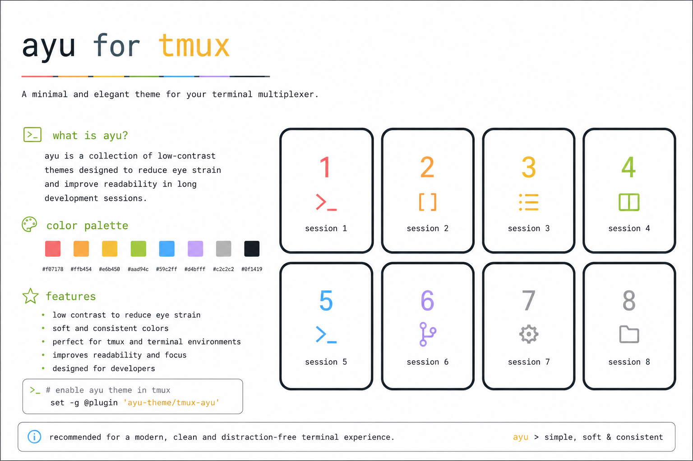
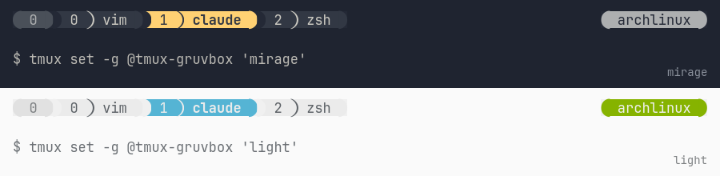
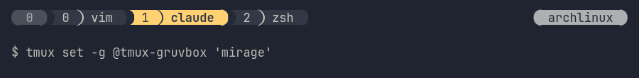
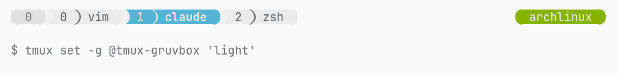
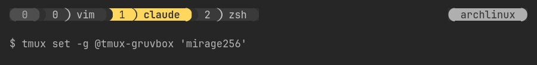
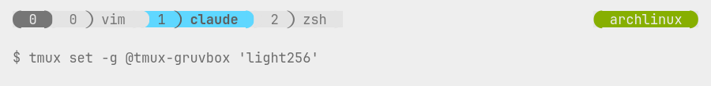

<div align="center">
    
    <h1>Ayu theme for Tmux</h1>
</div>

> **Disclaimer:** This is an **Ayu** theme for Tmux, a custom fork built on top of the original [egel/tmux-gruvbox][github-tmux-gruvbox] project, tailored to my personal needs. All credit for the original theme structure and plugin architecture goes to that project — huge thanks to its authors. For the original Gruvbox-flavored project, please visit [egel/tmux-gruvbox][github-tmux-gruvbox].

Theme with the [Ayu colorscheme][github-ayu] flavor for [Tmux][github-tmux], forked from and based on Pavel Pertsev's [gruvbox colorscheme][github-grovbox] plugin structure ([egel/tmux-gruvbox][github-tmux-gruvbox]) and inspired by work of [Gordon Chiam](https://gist.github.com/gchiam/4606522f513cc64b79ce). Subthemes switching inspired by [tmux-color-solarized][github-seebi-tmux-color-solarized].

<!--
  Using HTML table instead default markdown tables as provide it provide
  much better code readability especially for long columns.
-->

<div align="center">
  <a href="./public/comparison-mirage-light.png" target="_blank" title="Ayu mirage and light themes for Tmux">
    
  </a>
</div>

> Screenshot made with dark & light themes (16-bit) from macOS [alacritty][github-alacritty] terminal with xterm-256color and [Hack Nerd Font Regular][github-nerd-fonts]. Backgrounds by [Aleksandar Pasaric][pexcel-1] and [Vishnu Murali][pexcel-2].

## Installation

### Install via [TPM][github-tpm] (recommended)

Add plugin at the top list of TPM plugins list in `.tmux.conf` and select desired theme.

```bash
# ~/.tmux.conf

set -g @plugin 'tmux-plugins/tpm' # mandatory
set -g @plugin 'tmux-plugins/tmux-sensible' # optional recommended

set -g @plugin 'egel/tmux-gruvbox'
# set desired theme options...
set -g @tmux-gruvbox 'mirage' # or 'mirage256', 'light', 'light256'

# other plugins
...
```

Hit `prefix + I` to fetch the plugin and source it. Your Tmux should be updated with the theme at this point.

> [!NOTE]
> If you used v1 before and interested to adapt to v2 use this [Migration Guide from v1 to v2][docs-migration-guide-from-v1-to-v2].

### Install manually

> [!TIP]
> If you do not have github account [download](https://github.com/egel/tmux-gruvbox/archive/refs/heads/main.zip) it and unzip.

1.  Clone the project to desired location

    ```bash
    cd ~/projects/
    git clone ...
    ```

1.  Add theme at to top of your `~/.tmux.conf` config.

    ```bash
    # ~/.tmux.conf

    run ~/projects/tmux-gruvbox/tmux-gruvbox.tmux
    # set desired options...
    set -g @tmux-gruvbox 'mirage' # or 'mirage256', 'light', 'light256'
    ```

## Configuration options


### Theme

- default value: `mirage256`

| Theme name | Color palette | Preview link                                                          |
| :--------- | :------------ | :-------------------------------------------------------------------- |
| `mirage`   | 16-bit colors | <a href="./public/preview-mirage.png" target="_blank">preview</a> |
| `light`    | 16-bit colors | <a href="./public/preview-light.png" target="_blank">preview</a> |
| `mirage256`| 256 colors    | <a href="./public/preview-mirage256.png" target="_blank">preview</a> |
| `light256` | 256 colors    | <a href="./public/preview-light256.png" target="_blank">preview</a> |

<div align="center">
  
  
  
  
</div>

`light` is the standard Ayu Light. `dark` and `dark256` remain as aliases of `mirage` and `mirage256`.

```bash
set -g @tmux-gruvbox 'mirage' # mirage256, light, light256
```

> [!TIP]
> Each terminal emulator can behave bit differently regarding displaying colors.
> If you have some problems see
> [True Color (24-bit) and italics with alacritty + tmux + vim (neovim)][github-gist-andersevenrud-alacritty-tmux-vim-truecolor]
> where there is great wisdom how to adjust terminal, especially when used
> alacritty and tmux.

### Transparent status-bar

- default value: `'false'`
- tmux >= 3.2 (experimental)

```bash
set -g @tmux-gruvbox-statusbar-alpha 'true'
```

### Left Status (Section A)

- default value: `'#S'` (session name)

```bash
set -g @tmux-gruvbox-left-status-a '#S' # tmux's session name
```

### Right Status

- default value: `'#h'` (hostname)

This section is customizable for user, and by default contains hostname.

```bash
# display hostname and enhance section with other plugin
set -g @tmux-gruvbox-right-status-z '#h #{tmux_mode_indicator}'
```

> [!TIP]
> Make sure the themes' settings are defined before all other plugins,
> otherwise content from external plugins may not be displayed correctly by
> the theme.

## Development

To run project locally:

1.  clone the repository to desired place

    ```bash
    cd $HOME/projects/
    git clone ...
    ```

1.  create a symlink to the cloned repository (best in the standard [TPM][github-tpm] plugin directory):

    ```bash
    # cd to tmux plugin directory
    cd ~/.tmux/plugins/

    # create symlink to cloned repo
    ln -sf $HOME/projects/tmux-gruvbox/ tmux-gruvbox
    ```

1.  and in `~/.tmux.conf` set

    ```bash
    # ~/.tmux.conf
    set -g @plugin 'egel/tmux-gruvbox'
    # set desired options...
    set -g @tmux-gruvbox 'mirage'
    ```

### Linters & formatters

To keep the files clean we use few program to help us achieve it:

1.  Editorconfig (make sure your editor have it)
2.  Markdown (prettier/prettierd)
3.  Shell (shellcheck, shfmt)

## License

GPLv3 - Maciej Sypień

[docs-migration-guide-from-v1-to-v2]: ./docs/migration-guide-from-v1-to-v2.md
[github-alacritty]: https://github.com/alacritty/alacritty
[github-ayu]: https://github.com/ayu-theme/ayu-colors
[github-gist-andersevenrud-alacritty-tmux-vim-truecolor]: https://gist.github.com/andersevenrud/015e61af2fd264371032763d4ed965b6
[github-grovbox]: https://github.com/morhetz/gruvbox
[github-tmux-gruvbox]: https://github.com/egel/tmux-gruvbox
[github-hack]: https://github.com/chrissimpkins/Hack
[github-nerd-fonts]: https://github.com/ryanoasis/nerd-fonts
[github-seebi-tmux-color-solarized]: https://github.com/seebi/tmux-colors-solarized
[github-tmux]: https://github.com/tmux/tmux
[github-tpm]: https://github.com/tmux-plugins/tpm
[imgur-img-gruvbox-dark-16bit-1x]: https://i.imgur.com/ae88LQI.png
[imgur-img-gruvbox-dark-light-comparision-0.5x]: https://i.imgur.com/p6lUnzb.png
[imgur-img-gruvbox-dark-light-comparision-1x]: https://i.imgur.com/uGyGwlC.png
[imgur-img-gruvbox-dark256-1x]: https://i.imgur.com/kzQTTCa.png
[imgur-img-gruvbox-light-16bit-1x]: https://i.imgur.com/fvpdRjg.png
[imgur-img-gruvbox-light256-1x]: https://i.imgur.com/tQsl6LA.png
[pexcel-1]: https://www.pexels.com/photo/urban-photo-of-an-alley-2411688/
[pexcel-2]: https://www.pexels.com/photo/lights-hanging-above-the-alley-in-a-city-at-night-27044195/
